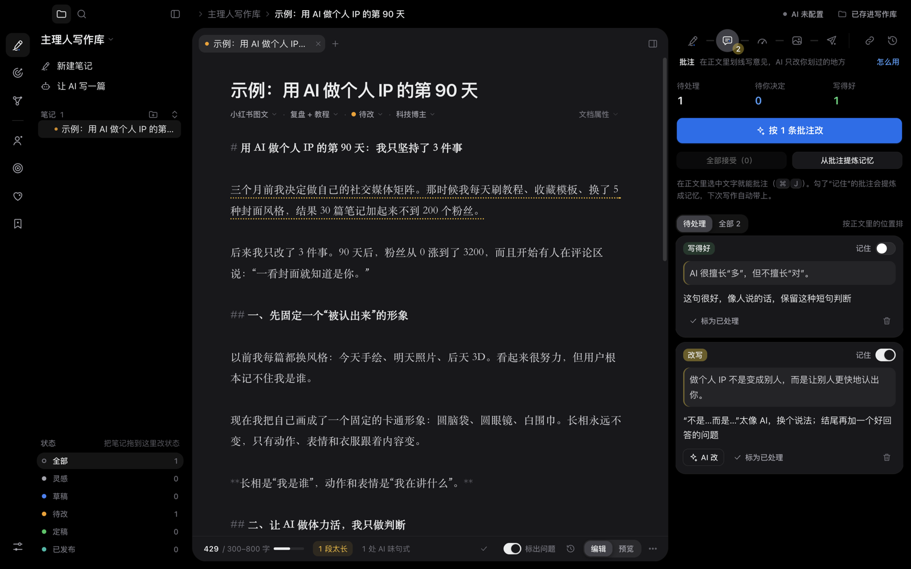
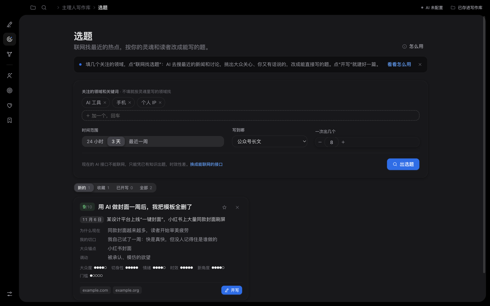
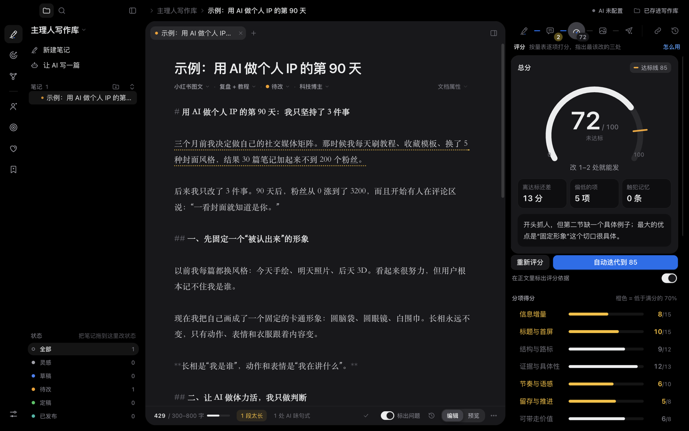
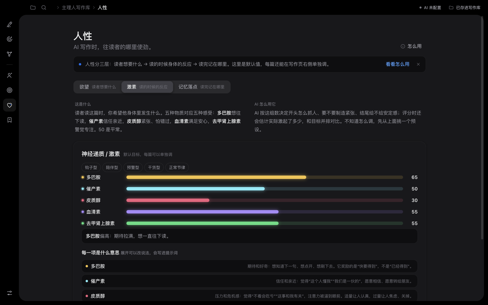
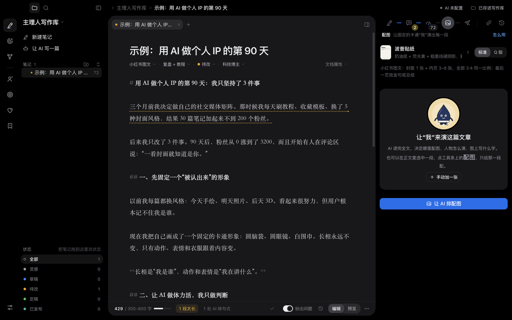

# Zhuliren Writing Desk (主理人写作台)

[中文](README.md) | **English**

A writing desk for content creators. Write yourself or let AI draft; highlight a passage and tell the AI exactly what to change, and it rewrites only that passage; the mistakes you correct become "memories" so they don't come back. Notes are plain `.md` files you can open in Obsidian.

Runs as a macOS app and as a web page. AI runs on your own API key: Claude, or any OpenAI-compatible service (DeepSeek, Kimi, Qwen…). **The interface is in Chinese**; this document gives the Chinese label next to each feature so you can find it.



## What it does

**Writing and revising**
- Start a note and write it yourself, or fill in the topic and requirements and let AI write the first draft
- Select a passage in the text: rewrite, cut, expand, add an example, illustrate… The AI changes only what you selected, and you accept or undo each change one by one
- Annotations marked "记住" (remember) are distilled into **memories**. Every later draft, revision and score carries them, and scoring checks whether a memory was broken again
- **Scoring** on a 100-point rubric, each item quoting the text; the "three things to fix first" turn into annotations in one click; auto-iterate until the target score
- Title ideas, alternative openings, per-platform distribution packs

**The AI's writing setup** (all editable, all included in every prompt)
- **灵魂 Soul**: who the author is, how they talk, what they care about, real experiences (the AI only uses experiences written here and never invents any)
- **心智 Audience distance**: how general the audience is. The lower the number, the more the AI explains with things everyone knows
- **人性 Human nature**: what readers want (a table of desires with philosophical notes), how their body reacts while reading (five hormones: dopamine, oxytocin, cortisol, serotonin, norepinephrine), and where the piece should land in memory (brainstem, amygdala, hippocampus, prefrontal cortex)
- Long-form posts, short posts, image posts and blogs each have platform specs; every number lives on the "参数" (settings) page

**Automatic topic finding (选题)**
- Enter a few fields you follow and click "联网找选题" (find topics online): the AI searches recent news and discussions and turns them into ready-to-write topics for your persona and readers
- Each topic carries the real event, its date, source links, your angle and six scores; "开写" (start writing) creates a note with the requirements already filled in

**Illustration (配图)**
- A fixed cartoon character acts out what each section explains. The AI plans the images and writes complete image prompts, or draws them directly through an OpenAI-compatible image API, then checks the finished image
- Select a passage and click "配图" on the toolbar to illustrate just that passage

**Note management** (inspired by Obsidian)
- Folder tree, drag to organize, drag a note onto a status to change its status
- `[[wikilinks]]`, backlinks, unlinked mentions, links updated automatically on rename
- Tabs and side-by-side split, quick switcher ⌘O, command palette ⌘P, graph view ⌘G, version history

| Topic finding | Scoring |
|---|---|
|  |  |
| **Human nature: hormones** | **Illustration** |
|  |  |

## Install

Only macOS (Apple silicon) for now, built from source:

```bash
git clone https://github.com/6mmLIU/writing-desk.git
cd writing-desk/desktop
npm install
npm run dist
```

The installer ends up at `desktop/dist/主理人写作台-<version>-arm64.dmg`. It isn't signed with a paid certificate: the first time, right-click the app → Open → Open again.

To just try it: `npm start` runs it without packaging.

On first launch it creates a "主理人写作库" (writing vault) folder in Documents. File › 打开写作库… (Open vault…) switches to any folder, including an existing Obsidian vault.

## Connecting AI

On first launch it asks for an API key (menu 主理人写作台 › AI 服务…). Keys are encrypted with the macOS keychain and stored in the app's own data folder. They never go into your vault and are never sent anywhere except the AI service you chose.

| Service | Setup | Web search (used by topic finding) |
|---|---|---|
| **Claude** | Anthropic API key; the three tiers default to Claude Opus 5.5 / Opus 5.5 / Haiku 5.5 | Anthropic's server-side web search |
| **DeepSeek** | Choose "OpenAI 兼容" (OpenAI-compatible), base URL `https://api.deepseek.com` | Switches to the Responses API's `web_search` with `deepseek-v4-pro` |
| **Kimi** | Moonshot's base URL | The built-in `$web_search` tool |
| **Qwen** | DashScope's compatible-mode base URL | `enable_search` |
| Other OpenAI-compatible services | Base URL and model names | No web search; topics come from the model's own knowledge |

"直接画" (draw directly) in illustration uses the image model of the OpenAI-compatible service (default `gpt-image-1`).

## Your data

- Every note is one `.md` file in the vault: the file name is the title, subfolders are note folders, and platform, status and tags live in the front matter
- Annotations, scores, versions, the topic pool and all settings live in the vault's `.writing-desk/` folder; images go into `attachments/`
- If another program edits a file, the desk refreshes automatically
- Apart from AI calls you trigger yourself, the app makes no network requests and uploads nothing

## Using your own character

The public version ships with an example character, "小墨" (Xiaomo, a navy-blue ink drop). To use your own brand character:

1. Create a `private/` folder at the repository root (already in `.gitignore`, never committed)
2. Put the character's reference images into `private/img/char/` with the same file names: `turnaround-sheet.jpg`, `expression-sheet.jpg`, `original.jpg` (avatar) and so on; see `img/char/` for the full list
3. Write the character's description into `private/character.js`, following `character` in `js/skilldata.js`:

   ```js
   window.SKILL.character = {
     name: "Me",
     identity_lock: "The character must be EXACTLY the person in the reference images — …",
     signature_outfit: "…",
     checklist: "Features to check one by one when reviewing a finished image…",
     variable: { … }, variants: { … }, accessories: { … },
   };
   ```

4. For style thumbnails that show your character, put them into `private/img/styles/`

`npm start`, `npm run dist` and the web version's `dev-server.py` all prefer files in `private/`.

## Web version

The same interface also runs in a browser (data stays in the browser):

```bash
python3 dev-server.py 4877
```

Open http://localhost:4877. Don't double-click `index.html`: it's only the page content and needs `dev-server.py` to wrap it in a page skeleton. The web version has no API key setting. Opened as a claude.ai Artifact it uses Claude; anywhere else, AI buttons give you the full prompt to copy elsewhere.

## Project layout

| Path | What it does |
|---|---|
| `index.html` | The page and all styles; design variables are in `:root` at the top |
| `js/core.js` | State, storage (vault / browser / cloud), AI calls, prompt assembly, local checks |
| `js/desk.js` | Writing page: file tree, tabs and split, the right-hand writing flow (write / annotate / score / publish…) |
| `js/editor.js` | Editor (textarea over a highlight mirror), annotation anchors, selection toolbar, `[[` autocomplete |
| `js/panels.js` | Soul, audience distance, human nature, memory and settings pages |
| `js/topics.js` | Topic finding |
| `js/illustrate.js` | Illustration plans and image prompts |
| `js/links.js` / `js/graph.js` | Wikilinks, backlinks, graph view |
| `js/palette.js` / `js/tour.js` | Command palette and shortcuts / first-use introductions |
| `js/defaults.js` | Factory defaults: writing rules, rubric, platform specs, souls, human nature, hormones and brain regions |
| `js/skilldata.js` | Illustration styles, platform sizes, staging patterns, the example character |
| `desktop/main.js` | macOS app window, menus, `app://` and `vault://` protocols |
| `desktop/vault.js` | Vault read/write (Markdown + YAML front matter, Obsidian-compatible) |
| `desktop/ai.js` | Claude (official SDK) and OpenAI-compatible services, web search, image generation |

Design and motion notes: [docs/DESIGN.en.md](docs/DESIGN.en.md).

## Development and tests

```bash
cd desktop
npm start                                   # run
npx electron smoke.js                       # run the key flows against a temporary vault
ANTHROPIC_BASE_URL=http://127.0.0.1:4890 npx electron smoke-ai.js   # test the AI paths against a local mock server
```

There is only one copy of the interface code: `desktop/build-web.mjs` copies the root `index.html`, `js/` and `img/` into the app. No bundler, no front-end framework.

Issues and pull requests are welcome. Before changing the interface, please read [docs/DESIGN.en.md](docs/DESIGN.en.md).

## License

[MIT](LICENSE). The example character "小墨" and the style cards are MIT-licensed as well.

The writing rules and the illustration system come from the author's own two Claude skills: article-craft (writing and scoring) and brand-ip-illustrator (brand character illustration).
