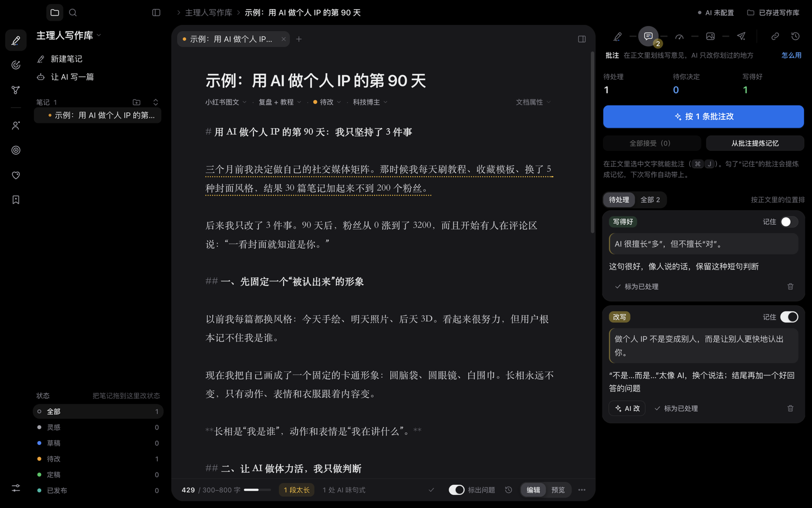
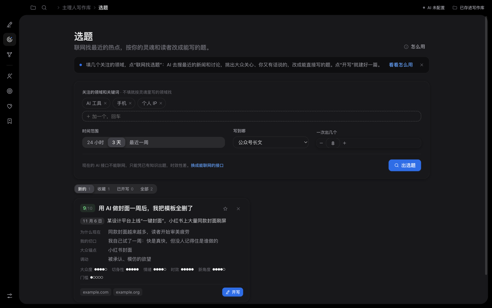
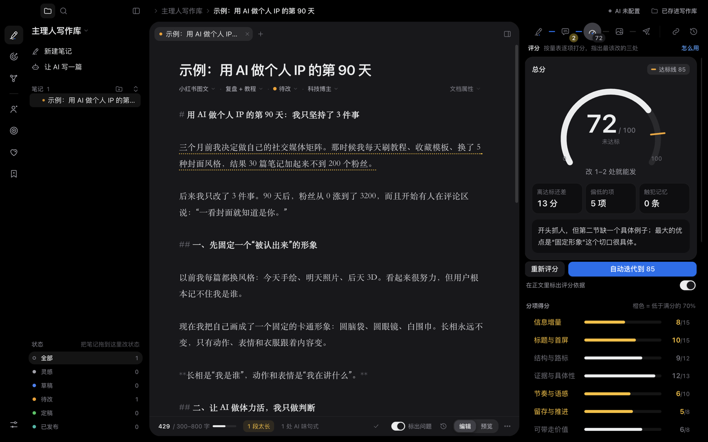
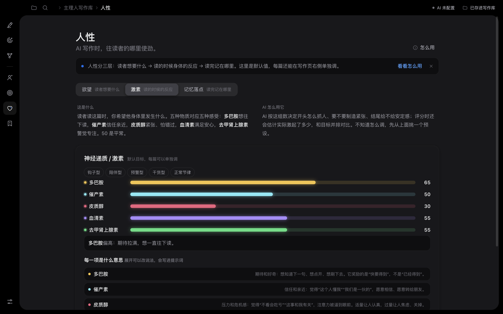
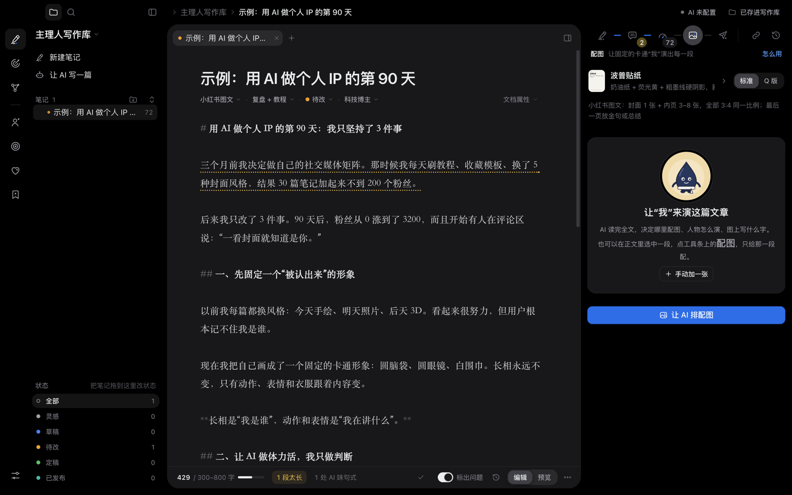

# 主理人写作台

**中文** | [English](README.en.md)

一个给内容创作者用的写作工作台：自己写、让 AI 写、划线批注让 AI 只改你划过的地方，把你纠正过的错误记下来，下次不再犯。笔记就是普通的 `.md` 文件，可以直接用 Obsidian 打开。



## 能做什么

**写作和改稿**
- 新建一篇自己写，或者填好题目和要求让 AI 写初稿
- 在正文里选中一段：改写、精简、扩写、加例子、配图……AI 只改你划过的地方，每处改动都能一条条接受或撤销
- 勾上“记住”的批注会提炼成**记忆**；之后写作、改稿、评分都会带上，评分时还会检查有没有再犯
- 按 100 分量表**评分**，每一项引用原文；“最该改的三处”可以一键转成批注；可以自动迭代到达标线
- 起标题、首屏备选、各平台分发包

**AI 的写作设定**（都能改，都会写进每一次提示词）
- **灵魂**：作者是谁、怎么说话、在乎什么、真实经历（AI 只用这里写到的经历，不编）
- **心智**：写给多大众的人。越低越用人人都懂的东西打比方
- **人性**：读者想要什么（欲望表，带哲学解释）、读的时候身体有什么反应（多巴胺、催产素等五种激素）、读完记在哪里（脑干、杏仁核、海马体、前额叶）
- 写长文、帖子、贴图、博客各有平台规格；所有数字都在“参数”页

**自动选题**
- 填几个关注的领域，点“联网找选题”：AI 搜最近的新闻和讨论，按你的灵魂和读者改成能直接写的题
- 每个选题带真实事件、日期、来源链接、切口和 6 项打分；点“开写”就新建一篇并把要求填好

**配图**
- 一个固定的卡通人物“演出”每一段在讲的东西：AI 排配图计划、写完整的生图提示词，或者用 OpenAI 的生图接口直接画，画好让 AI 看图检查
- 在正文里选中一段，点工具条上的“配图”，只给那一段配一张

**笔记管理**（参考 Obsidian）
- 文件夹树、拖动整理、把笔记拖到“状态”上改状态
- `[[双链]]`、反向链接、未链接的提及、改名时自动更新链接
- 标签页和左右分屏、快速切换 ⌘O、命令面板 ⌘P、关系图谱 ⌘G、版本历史

| 自动选题 | 评分 |
|---|---|
|  |  |
| **人性：激素** | **配图** |
|  |  |

## 安装

目前只提供 macOS（Apple 芯片）版，需要自己从源码打包：

```bash
git clone https://github.com/6mmLIU/writing-desk.git
cd writing-desk/desktop
npm install
npm run dist
```

打包好的安装包在 `desktop/dist/主理人写作台-<版本>-arm64.dmg`。没有付费签名，第一次打开时在 App 上点右键 → 打开 → 再点一次“打开”。

只想先看看：`npm start` 直接运行，不用打包。

第一次打开会在“文稿”里建一个“主理人写作库”文件夹。菜单 文件 › 打开写作库… 可以换成任何文件夹，包括现有的 Obsidian 库。

## 接入 AI

第一次打开会让你填 API key（菜单 主理人写作台 › AI 服务…）。key 用 macOS 钥匙串加密，存在 App 自己的数据目录里，不会进写作库，也不会发给除了你选的 AI 服务以外的任何地方。

| 服务 | 怎么填 | 联网搜索（自动选题用） |
|---|---|---|
| **Claude** | 填 Anthropic 的 API key；三档模型默认 Claude Opus 5.5 / Opus 5.5 / Haiku 5.5 | 用 Anthropic 的服务端联网搜索 |
| **DeepSeek** | 选“OpenAI 兼容”，接口地址 `https://api.deepseek.com` | 自动改走 Responses 接口的 `web_search`，用 `deepseek-v4-pro` |
| **Kimi** | 接口地址填 Moonshot 的地址 | 用内置的 `$web_search` 工具 |
| **通义千问** | 接口地址填 DashScope 的兼容地址 | 打开 `enable_search` |
| 其它 OpenAI 兼容服务 | 填接口地址和模型名 | 不能联网；选题只能凭模型已有的知识 |

配图的“直接画”用 OpenAI 兼容接口的生图模型（默认 `gpt-image-1`）。

## 你的数据

- 每篇笔记是写作库里的一个 `.md` 文件：文件名就是标题，子文件夹就是笔记文件夹，平台、状态、标签写在文件开头的属性里
- 批注、评分、版本、选题池和各种设定存在写作库的 `.writing-desk/` 里；配图存在 `attachments/`
- 在别的程序里改了文件，写作台会自动刷新
- 除了你主动触发的 AI 调用，写作台不联网、不上传任何东西

## 换成你自己的人物

公开版自带一个示例角色“小墨”（藏青色的墨水滴）。换成你自己的品牌人物：

1. 在仓库根目录建一个 `private/` 文件夹（已经在 `.gitignore` 里，不会被提交）
2. 把人物参考图按同样的文件名放进 `private/img/char/`：`turnaround-sheet.jpg`（三视图）、`expression-sheet.jpg`（表情表）、`original.jpg`（头像）等，文件名见 `img/char/`
3. 把人物的文字设定写进 `private/character.js`，格式照 `js/skilldata.js` 里的 `character`：

   ```js
   window.SKILL.character = {
     name: "我",
     identity_lock: "The character must be EXACTLY the person in the reference images — …",
     signature_outfit: "…",
     checklist: "看图检查时逐项核对的特征……",
     variable: { … }, variants: { … }, accessories: { … },
   };
   ```

4. 想要带人物的风格缩略图，放进 `private/img/styles/`

`npm start`、`npm run dist` 和网页版的 `dev-server.py` 都会优先用 `private/` 里的文件。

## 网页版

同一套界面也能在浏览器里用（数据存在浏览器里）：

```bash
python3 dev-server.py 4877
```

打开 http://localhost:4877 。不要直接双击 `index.html`：它只是页面的内容部分，要靠 `dev-server.py` 包上页面骨架。网页版没有 API key 设置：在 claude.ai 的 Artifact 里打开时用 Claude，其它地方点 AI 按钮会给出完整提示词，复制去别处用。

## 项目结构

| 路径 | 作用 |
|---|---|
| `index.html` | 页面和全部样式；顶部 `:root` 是设计变量 |
| `js/core.js` | 状态、存储（写作库 / 浏览器 / 云端）、AI 调用、提示词拼装、本地检查 |
| `js/desk.js` | 写作页：文件树、标签页和分屏、右侧写作流程（写作 / 批注 / 评分 / 发布…） |
| `js/editor.js` | 编辑器（textarea + 高亮镜像层）、批注锚点、选区工具条、`[[` 补全 |
| `js/panels.js` | 灵魂、心智、人性、记忆、参数页面 |
| `js/topics.js` | 自动选题 |
| `js/illustrate.js` | 配图计划和生图提示词 |
| `js/links.js` / `js/graph.js` | 双链、反向链接、关系图谱 |
| `js/palette.js` / `js/tour.js` | 命令面板和快捷键 / 第一次使用的介绍 |
| `js/defaults.js` | 出厂默认值：写作规则、评分量表、平台规格、灵魂、人性表、激素和脑区 |
| `js/skilldata.js` | 配图风格、平台尺寸、演绎方式、示例角色 |
| `desktop/main.js` | Mac App 的窗口、菜单、`app://` 和 `vault://` 协议 |
| `desktop/vault.js` | 写作库读写（Markdown + YAML 属性，兼容 Obsidian） |
| `desktop/ai.js` | Claude（官方 SDK）和 OpenAI 兼容接口、联网搜索、生图 |

设计和动效的说明见 [docs/DESIGN.md](docs/DESIGN.md)。

## 开发和测试

```bash
cd desktop
npm start                                   # 运行
npx electron smoke.js                       # 用临时写作库跑一遍关键流程
ANTHROPIC_BASE_URL=http://127.0.0.1:4890 npx electron smoke-ai.js   # 配合本地假服务测 AI 通路
```

界面代码只有一份：`desktop/build-web.mjs` 把根目录的 `index.html`、`js/`、`img/` 复制进 App。不用打包工具，也没有前端框架。

欢迎提 issue 和 pull request。改界面之前建议先读一遍 [docs/DESIGN.md](docs/DESIGN.md)。

## 许可证

[MIT](LICENSE)。示例角色“小墨”和风格卡片同样按 MIT 授权。

写作规则和配图系统来自作者自己的两个 Claude skill：article-craft（写作和评分）与 brand-ip-illustrator（品牌人物配图）。
